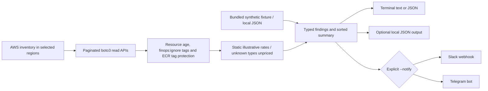

# FinOps Resource Auditor

[](https://github.com/huy8114644/finops-resource-auditor/actions/workflows/ci.yml)

A Python 3.11+ CLI for reviewing AWS resources that may no longer be needed. It gathers read-only inventory, applies age and exclusion rules, and reports candidates with illustrative cost estimates. The project helps operators assemble a review queue; it does not prove waste, historical idleness or achievable savings, and implements no cleanup commands.

## Architecture and data flow



| Candidate | Actual qualification | Interpretation and pricing limit |
| --- | --- | --- |
| EBS | Currently `available`, no attachments, creation age at least 14 days by default | Detach age is unknown; storage-only static rate by volume type |
| Snapshots | Owned by account, completed, at least 90 days old | AMI/backup dependencies need review; incremental billed storage is unknown, so unpriced |
| ELBv2 | At least 14 days old and no registered targets across target groups | No traffic-history check; fixed-response listeners may still serve traffic; ALB/NLB base estimate is $16.43/month, other types unpriced |
| ECR | At least 30 days since push; untagged by default | Last use is unknown; reported bytes × $0.10/GiB may double-count shared layers |

`finops:ignore=true` excludes volumes, snapshots and load balancers, and excludes all images in a tagged ECR repository. Tagged images require `--include-tagged-ecr`; protected image tags still exclude them. The tag comparisons follow the code's exact keys and image tag spelling. Prices are static examples applied across all regions, not an AWS price feed. See [cost methodology and review workflow](docs/cost-methodology.md).

## Local quickstart

Requirements: Python 3.11+ and Make. Docker is optional as a fallback for Gitleaks; the repository has no application Dockerfile or Compose deployment.

```bash
make                 # help only
make setup           # local venv and editable package with dev tools
make lint
make typecheck
make test            # offline Stubber tests; coverage gate 85%
make plan            # synthetic JSON on stdout; no AWS or notifications
make audit-demo      # synthetic text report
make scan            # local Gitleaks or pinned Docker image; fails if unavailable
make build           # wheel and source archive
.venv/bin/finops-audit --demo --format json --output demo-report.json
```

The demo is synthetic and is not evidence of real savings. Local tests use dummy credentials and disable instance metadata. No Make target performs a live scan or sends a notification. `scan` checks working-tree content, including untracked files; it does not audit Git history. Scanner findings and tool failures cause a nonzero exit.

## Configuration

Select exactly one input mode: `--demo`, `--fixture PATH`, or `--live`. No input mode is implicit.

| CLI option | Default | Purpose |
| --- | --- | --- |
| `--regions` | `us-east-1` | Comma-separated regions for live inventory; fixture supplies its own regions |
| `--volume-days` / `--snapshot-days` | `14` / `90` | Minimum creation age in days |
| `--lb-days` / `--image-days` | `14` / `30` | Minimum load-balancer creation / image push age |
| `--include-tagged-ecr` | Off | Include old tagged images except protected tags |
| `--protected-tags` | `latest,prod,production,stable` | Exact protected ECR tag names |
| `--format` | `text` | Terminal `text` or `json` |
| `--output` | Unset | Write JSON report locally regardless of terminal format |
| `--notify` | Unset | Explicit `slack` or `telegram` summary delivery; also works in demo mode |

| Environment | Default / source | Purpose |
| --- | --- | --- |
| `AWS_PROFILE` | boto3 credential chain | Optional local named profile for live mode; CLI has no `--profile` option |
| `AWS_ACCESS_KEY_ID`, `AWS_SECRET_ACCESS_KEY`, `AWS_SESSION_TOKEN` | boto3 credential chain | Alternative credentials for live mode; prefer short-lived credentials |
| `AWS_DEFAULT_REGION` | boto3 environment setting | Does not override CLI `--regions`, which explicitly defaults to `us-east-1` |
| `AWS_EC2_METADATA_DISABLED` | SDK setting; `true` in tests/CI | Disables instance metadata credential lookup |
| `FINOPS_SLACK_WEBHOOK` | Unset | Required only for `--notify slack`; HTTPS Slack services URL |
| `FINOPS_TELEGRAM_TOKEN` / `FINOPS_TELEGRAM_CHAT_ID` | Unset | Required only for `--notify telegram` |

There is no `.env` loader. Export values in your shell or use a managed execution environment; never commit credentials, webhooks, tokens or real inventory reports.

## CI and delivery

```mermaid
flowchart LR
    Trigger[Push / PR / manual / daily schedule] --> Matrix[Python 3.11 and 3.12]
    Matrix --> Lint[Ruff and strict mypy]
    Lint --> Tests[Offline tests with 85 percent coverage gate]
    Tests --> Build[Build wheel and source archive]
    Build --> Demo[Generate synthetic JSON]
    Demo --> Artifacts[Upload report, coverage and packages for 7 days]
    Artifacts --> Review[Review evidence and selected revision]
    Review --> Operator[Operator installs reviewed package manually]
```



CI uses dummy AWS credentials and performs no live AWS scans, notifications or package publication. Gitleaks is available via `make scan` but is not currently a CI job. Workflow definitions describe intended checks; consult actual runs before claiming success or a measured coverage percentage.

To deliver, build and validate a chosen revision, install its wheel in an isolated virtual environment, and run `finops-audit --demo --format json`. Retain the previous wheel and dependency environment for rollback. No service, cloud infrastructure or scheduler is deployed by this repository. If you add a scheduler externally, disable it before changing versions; restore the prior environment to roll back the CLI. Reports and already delivered notifications cannot be recalled by a package rollback.

For an explicitly authorized live review, use a dedicated least-privilege read role based on [the example policy](docs/read-only-policy.json), verify account/regions, and run:

```bash
AWS_PROFILE=review .venv/bin/finops-audit --live \
  --regions us-east-1,us-west-2 --format json --output report.json
```

Live mode contacts AWS and can incur API charges or throttling. Review ownership, retention, dependencies, observed traffic and current regional billing before taking action through a separately approved workflow. Notifications are a separate explicit CLI opt-in; local development and CI should keep that option unset.

See [CONTRIBUTING.md](CONTRIBUTING.md). Licensed under [MIT](LICENSE).

[Local validation evidence](docs/local-validation.md) records measured checks and the limits of this documentation revision.
