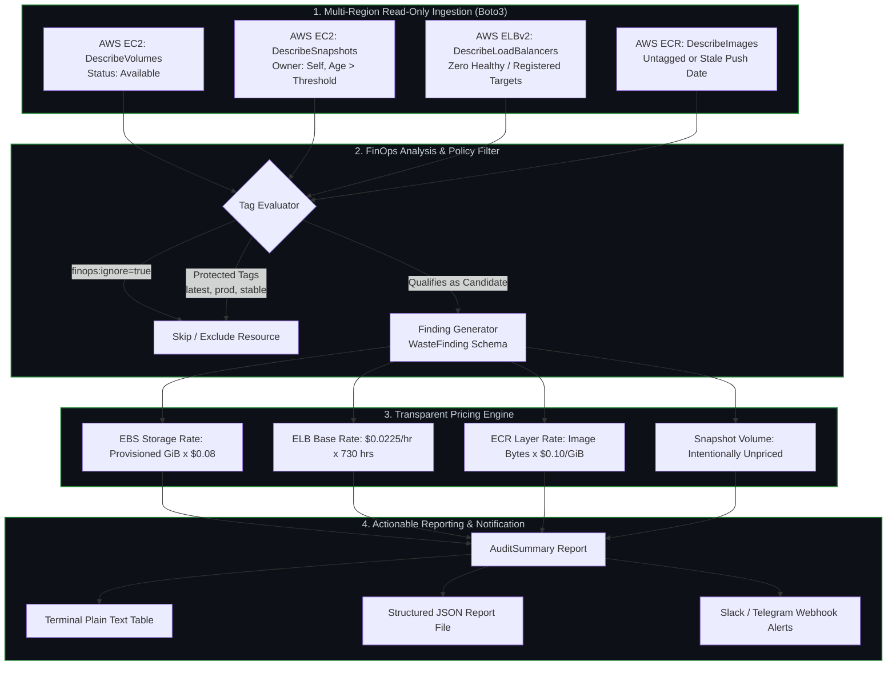

# FinOps Resource Auditor

[](https://github.com/huy8114644/finops-resource-auditor/actions/workflows/ci.yml)
[](https://python.org)
[](docs/read-only-policy.json)
[](tests/)
[](LICENSE)

Production-grade, **Read-Only AWS FinOps CLI and Automation Engine** that discovers abandoned cloud assets, calculates transparent cost savings estimates, and alerts engineering teams without modifying cloud state.

---

## 🎯 Problem Statement & Core Value

Over 30% of enterprise cloud spend is wasted on abandoned, orphaned resources — unattached EBS volumes left after EC2 termination, aged snapshots without retention policies, idle Application Load Balancers with zero registered targets, and legacy container images.

This tool delivers safe, automated FinOps governance:
1. **Strictly Read-Only:** Zero deletion or mutation APIs; safe to execute in production environments without change advisory boards.
2. **Transparent Cost Methodology:** Plainly documents assumptions (storage rates, base hourly ELB rates) and marks non-attributable assets (EBS snapshot incremental blocks) as `unpriced` rather than guessing.
3. **Multi-Region & Automated Alerts:** Dispatches executive summary reports to Slack incoming webhooks or Telegram bot channels.

---

## 🏛️ FinOps Auditing Architecture



---

## 🔒 Resource Detection & Cost Methodology

| Target Resource | Qualification Rule | Pricing Model | Caveat & Review Guidance |
|---|---|---|---|
| **Unattached EBS** | `State == 'available'` & age >= `volume_days` | Provisioned GiB × $0.08/mo (gp3) | Detach timestamp is unrecorded by AWS; verify snapshot history |
| **Aged Snapshots** | `State == 'completed'` & age >= `snapshot_days` | **Unpriced** (`null`) | Provisioned size is not billed incremental delta; check AMI dependencies |
| **Idle Load Balancers** | Zero registered targets across all target groups | Base hourly rate ($0.0225/hr × 730 hrs) | Excludes capacity units (LCU); verify DNS cutover before decommissioning |
| **Old ECR Images** | Untagged or age >= `image_days` (unprotected) | Uncompressed size × $0.10/GiB | Shared layers can overstate savings; verify rollback tags |

---

## ⚙️ Environment Variables & Configuration

The auditor is configured via environment variables and CLI arguments:

| Variable | Type | Default | Description |
|---|---|---|---|
| `AWS_PROFILE` | String | `null` | Named AWS CLI profile granting read-only credentials |
| `AWS_DEFAULT_REGION` | String | `us-east-1` | Default fallback AWS region |
| `FINOPS_SLACK_WEBHOOK` | String | `null` | Slack incoming webhook URL for automated summary delivery |
| `FINOPS_TELEGRAM_TOKEN` | String | `null` | Telegram Bot token for incident alerts |
| `FINOPS_TELEGRAM_CHAT_ID` | String | `null` | Telegram channel or group chat ID |

---

## 🚀 Local Developer Quickstart

Standardized operational tasks are automated via the included `Makefile`:

```bash
# 1. View all available Makefile commands
make help

# 2. Setup virtual environment and development dependencies
make setup

# 3. Run Ruff linter and code formatting check
make lint

# 4. Run Mypy static type verification (strict mode)
make typecheck

# 5. Execute Pytest test suite with code coverage
make test

# 6. Execute offline FinOps discovery demo (no AWS account required)
make audit-demo
```

---

## ☸️ Live AWS Multi-Region Scanning

```bash
# Run against live AWS account with custom thresholds
finops-audit --live \
  --regions us-east-1,us-west-2,ap-southeast-1 \
  --volume-days 14 \
  --snapshot-days 90 \
  --lb-days 14 \
  --output live-report.json

# Send summary alert to Slack
finops-audit --demo --notify slack
```

---

## 📄 License
This project is licensed under the MIT License - see the [LICENSE](LICENSE) file for details.
